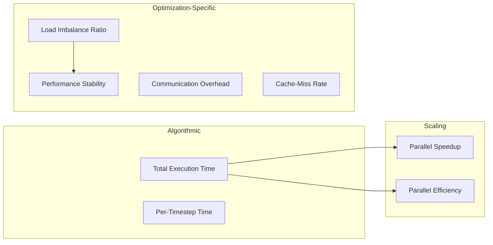
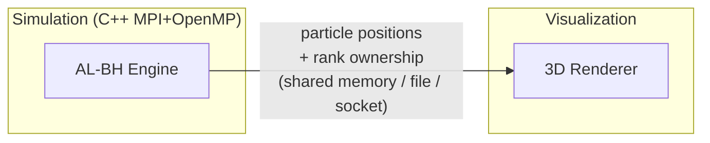
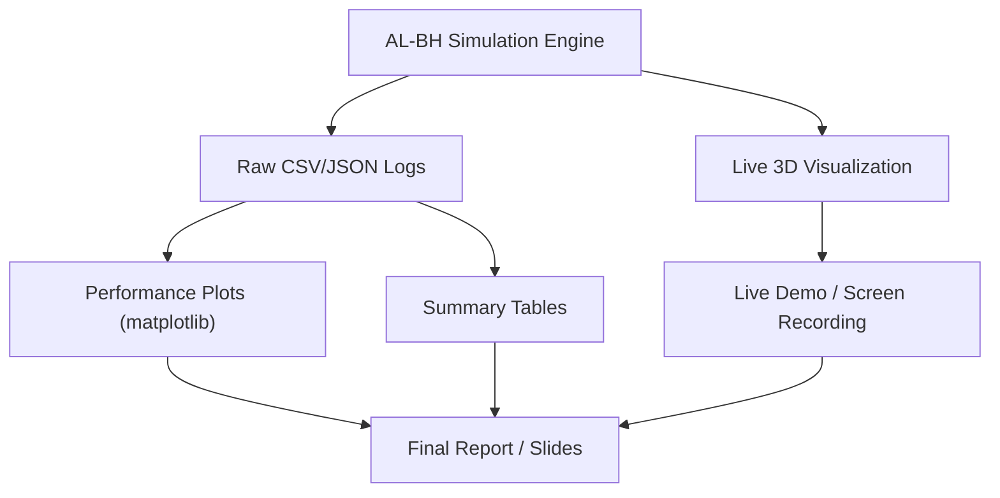

# AL-BH: Deliverables, Metrics, Output Presentation & Live Simulation Plan

## Goal
Clarify what the AL-BH project produces, how it's evaluated, and how we present results — including a **live 3D star simulation** — in the context of a **Parallel Computing** course.

---

## 1. Project Deliverables — What You Actually Submit / Demo

The project has **three output categories**:

### A. The Simulation Engine (Code)
| Deliverable | Description |
|---|---|
| Full AL-BH simulator | Hybrid MPI + OpenMP C++ code with all 4 optimizations |
| 3 baseline implementations | Serial BH, static-partition BH, no-rebalance BH |
| Correctness test suite | Unit tests for Morton keys, Octree, forces, partitions, ghost exchange |
| Build system | CMake — one-command build |
| Experiment automation | Scripts to sweep parameters and collect CSVs |

### B. Performance Results (Data + Plots)
Raw CSV/JSON logs from experiment runs → processed into publication-quality plots and tables.

### C. Live Visualization (Demo)
A **real-time 3D rendering** of the N-body simulation showing stars moving under gravity — the "wow factor" for your presentation. More on this in [Section 4](#4-live-3d-star-simulation--the-proposal).

---

## 2. Evaluation Metrics — How You Prove the Optimizations Work

The context document specifies **8 core metrics**. Here's what each one is, how it's measured, and what comparison it serves:

### Metric Map



| # | Metric | Formula / Method | Tool | Proves |
|---|---|---|---|---|
| 1 | **Total execution time** | Wall-clock time for full run | `MPI_Wtime()` | AL-BH is faster than baselines |
| 2 | **Per-timestep time** | Time each timestep takes | `MPI_Wtime()` per step | Performance stability across timesteps |
| 3 | **Parallel speedup** | $S = T_1 / T_p$ (serial time / parallel time) | Derived from #1 | More ranks/threads → faster |
| 4 | **Parallel efficiency** | $E = S / p$ (speedup / number of processors) | Derived from #3 | How close to ideal linear scaling |
| 5 | **Load imbalance ratio** | $\text{max}(W_i) / \text{min}(W_i)$ per timestep | Per-rank timers + particle counts | Adaptive rebalancing keeps work even |
| 6 | **Communication overhead** | Time in MPI send/recv/wait | Instrument MPI calls | Non-blocking hides latency |
| 7 | **Cache-miss rate** | L1/L2/L3 cache misses during tree traversal | `perf stat` / PAPI hardware counters | Linearized Octree has fewer misses |
| 8 | **Performance across timesteps** | Trend of per-step time as particles move | Time series plot | Static partition degrades; adaptive doesn't |

### Experiment Dimensions (Parameter Sweeps)

| Parameter | Values |
|---|---|
| N (particles) | 10⁴, 10⁵, 10⁶ |
| Distribution | Uniform, Clustered (Plummer) |
| θ (opening angle) | 0.3, 0.5, 0.7 |
| MPI ranks | 1, 2, 4, 8, 16 |
| OpenMP threads/rank | 1, 2, 4, 8 |
| Rebalance threshold | 1.1, 1.2, 1.5 |
| Scaling type | Strong scaling, Weak scaling |

### Key Comparisons

| Comparison | What's Isolated |
|---|---|
| AL-BH vs. Serial BH | Overall improvement from all optimizations |
| AL-BH vs. Static-partition BH | Morton decomposition benefit |
| AL-BH vs. No-rebalance BH | Adaptive load balancing benefit |
| Linearized Octree vs. Pointer-based Octree | Cache locality benefit |
| Non-blocking MPI vs. Blocking MPI | Communication overlap benefit |
| Rebalancing ON vs. OFF | Dynamic load balancing benefit |

---

## 3. How Results Are Presented — Course-Worthy Output

For a parallel computing course, the presentation needs to clearly demonstrate **scaling, bottlenecks, and optimization impact**. Here's the concrete output plan:

### 3.1 Performance Plots (auto-generated from experiment CSVs)

| Plot | Type | X-axis | Y-axis | Series |
|---|---|---|---|---|
| **Strong Scaling** | Line | MPI ranks (1–16) | Speedup | AL-BH vs baselines |
| **Weak Scaling** | Line | MPI ranks (N scales with p) | Execution time | AL-BH vs baselines |
| **Parallel Efficiency** | Line | MPI ranks | Efficiency (0–1) | AL-BH vs ideal |
| **Load Imbalance Over Time** | Line | Timestep | max/min ratio | Adaptive ON vs OFF |
| **Communication Breakdown** | Stacked bar | MPI ranks | Time (compute / comm / wait) | Blocking vs non-blocking |
| **Cache Miss Comparison** | Grouped bar | Tree type | Cache misses | Linearized vs pointer-based |
| **Theta Accuracy/Speed Tradeoff** | Scatter | θ value | Time vs. force error | Show the tradeoff |
| **Per-Timestep Time Series** | Line | Timestep | Time | Static vs adaptive (shows degradation) |

### 3.2 Summary Tables

- Speedup & efficiency table (ranks × threads)
- Best configuration per particle count
- Rebalancing event log (when triggered, particles moved, time cost)

### 3.3 Console Output During Runs

```
[Timestep 042/500] N=100000 | Ranks=8 | θ=0.5
  Force compute:  0.234s  |  Comm:  0.018s  |  Rebalance:  0.003s
  Imbalance: 1.08  |  Particles migrated: 342
  Total step: 0.255s
```

---

## 4. Live 3D Star Simulation — The Proposal

> [!TIP]
> A live visualization running during your demo will make the project **dramatically more memorable** for a parallel computing course presentation. It turns abstract metrics into something visually tangible.

### What I'm Proposing

A **real-time 3D rendering window** that shows:

1. **Particles as glowing stars** moving under gravitational attraction
2. **Color-coded by MPI rank ownership** — you can literally *see* which process owns which region
3. **Octree grid overlay** (toggleable) — shows the spatial subdivision
4. **Morton curve path** (toggleable) — shows the Z-order space-filling curve threading through particles
5. **Live stats overlay** — FPS, timestep, imbalance ratio, particle count per rank
6. **Rebalancing events highlighted** — flash when partition boundaries shift

### Architecture



### Two Implementation Options

| Option | Tech | Pros | Cons |
|---|---|---|---|
| **A: Python + PyOpenGL/Vispy** | Python script reads particle dumps each timestep | Easy to build, great interactivity, can run separately from sim | Slight lag (file I/O), needs Python + OpenGL |
| **B: Web-based (Three.js)** | Simulation writes JSON/binary, browser renders in 3D | Runs anywhere, shareable, beautiful out of the box | Needs a small web server, slightly more setup |

> [!IMPORTANT]
> **My recommendation: Option A (Python + Vispy/PyOpenGL)** for these reasons:
> - Vispy can handle 10⁵–10⁶ particles smoothly using GPU instancing
> - Runs locally with no browser/server overhead
> - Easy to add Octree wireframes and Morton curve overlay
> - Screenshot/record for the report with one click
> - The simulation dumps particle state to a binary file each timestep; the visualizer reads and renders in a loop

### What the Demo Looks Like

```
┌─────────────────────────────────────────────────┐
│  AL-BH Live Simulation          [Pause] [Reset] │
│                                                  │
│         ★  ·  ·     ·  ★                         │
│      ·    ★ ★  ·  ·      ·                       │
│    ·   ★  ★★★★  ·    ·     ·                     │
│      ·  ★★★★★★★  ·     ·                         │
│    ·   ★★★★★★★★  ·   ·    ·                      │
│      ·  ★★★★★★  ·      ·                         │
│    ·   ★  ★★  ·    ·      ·                      │
│      ·    ★  ·  ·       ·                        │
│         ·  ·     ·   ·                           │
│                                                  │
│  ┌──────────────────────────────────────────┐    │
│  │ Step: 42/500  N: 100K  Ranks: 8         │    │
│  │ Imbalance: 1.08  FPS: 30                │    │
│  │ ■ Rank0 ■ Rank1 ■ Rank2 ■ Rank3        │    │
│  │ ■ Rank4 ■ Rank5 ■ Rank6 ■ Rank7        │    │
│  └──────────────────────────────────────────┘    │
└─────────────────────────────────────────────────┘
```

Stars are colored by owning MPI rank. You can rotate/zoom the view. The cluster forms, evolves, and you *see* load rebalancing happen as colors shift at partition boundaries.

### Visualization Features for the Course Demo

| Feature | Parallel Computing Relevance |
|---|---|
| **Rank coloring** | Shows domain decomposition — core parallel concept |
| **Octree grid overlay** | Shows hierarchical spatial subdivision |
| **Morton curve** | Shows space-filling curve mapping 3D → 1D |
| **Rebalance flash** | Shows dynamic load balancing in action |
| **Side-by-side mode** | Run static vs adaptive simultaneously — visual proof |
| **Particle migration trails** | Shows particles moving between ranks |

---

## 5. Complete Output Summary



| Output | Format | Purpose |
|---|---|---|
| Raw experiment logs | CSV + JSON metadata | Reproducibility |
| Performance plots (8+ types) | PNG/SVG via matplotlib | Quantitative evaluation |
| Summary tables | Markdown / LaTeX | Paper/slides inclusion |
| Console progress output | Terminal text | During runs |
| **Live 3D visualization** | Interactive window (Vispy) | Demo & engagement |
| Screen recording of sim | MP4 | For slides if live demo fails |
| README + build instructions | Markdown | Reproducibility |

---

## Open Questions for You

> [!IMPORTANT]
> Before I start building, I need your input on these:

1. **What hardware are you running on?** (personal laptop? university HPC cluster? how many cores?) — This determines realistic rank/thread counts for experiments.

2. **Do you have MPI installed?** (MS-MPI on Windows? or will you run on a Linux cluster?) — C++ MPI on Windows needs MS-MPI; Linux is more standard.

3. **For the visualization — do you want it as part of the graded deliverable, or just for the demo?** This affects how much time we invest in polish.

4. **How much time do you have before the deadline?** — This determines whether we do all 7 milestones or prioritize.

5. **Is there a specific report format required?** (IEEE template, free-form, slides only?)

6. **For the live sim — are you comfortable with Python (Vispy) for visualization, or would you prefer a web-based (Three.js) approach?**
